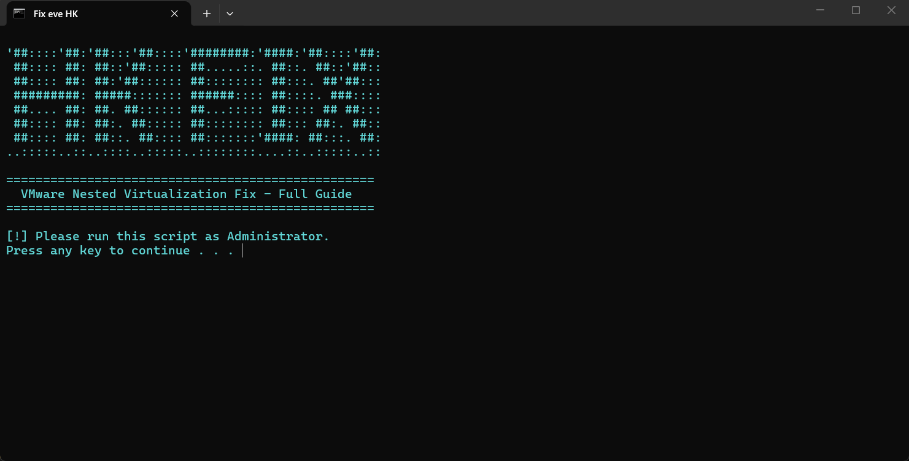

<h1 align="center">Fix EVE HK</h1>

<b>One-click script that frees VT-x so VMware can run nested virtualization</b>

  
  
  
  

---

## Overview
Windows features such as Hyper-V, VBS and Device Guard take over the CPU virtualization extensions and stop VMware Workstation from running nested hypervisors (for example EVE-NG). This script disables them step by step and tells you what is left to do manually.

## Features
- Pre-check of the current Hyper-V state
- Disables the Windows hypervisor launch type (bcdedit)
- Disables Hyper-V optional features (DISM) and related services
- Turns off VBS / Device Guard / Credential Guard policies
- Guides you through the manual Tamper Protection and Memory Integrity steps
- Post-check and optional full shutdown

## Screenshots

## Download and install
### Option A - Ready-to-run download (recommended)
1. Open the **[Releases page](https://github.com/alisadhk/fix-eve-hk/releases/latest)**.
2. Download the file(s) listed under **Assets**:

| File | Size |
|---|---|
| `Fix-EVE-HK.exe` | 0.1 MB |

3. Run it. Run it as Administrator; Windows UAC will ask for confirmation.

### Option B - Run the script
Download the script from this repository and run it as described in **How to use**.

## How to use
1. Right-click **Fix-EVE-HK.exe** (or the .cmd script) and choose **Run as administrator**.
2. Follow the on-screen steps 1 to 7. Each step prints what it changes.
3. When asked, turn off **Tamper Protection** and **Memory Integrity** manually in Windows Security.
4. Do a full shutdown (not a restart) when the script asks, then power the PC on again.
5. Start your VMware VM and verify that nested virtualization works.

## Configuration and privacy
- The script contains no credentials or personal data.

## Notes
- **Security warning:** this lowers Windows virtualization-based security. Only run it on a lab/test machine and review the script first.
- To undo the changes, re-enable Hyper-V and Memory Integrity from Windows Features / Windows Security.

---

Maintained by <a href="https://github.com/alisadhk">@alisadhk</a> - last update 2025-09-22
